# 2. Подсистемы и границы ответственности

[К оглавлению HLD](../customer-support-agent-hld.md) · [Состояние](02-state-lifecycle.md) · [Сценарии](03-scenarios.md)

## 2.1. Иерархия компонентов

[Исходник Mermaid](../../images/01-components.mmd). Схема показывает дерево «система → подсистема → компонент». Стрелки обозначают состав, а не вызовы во время исполнения. Потоки взаимодействия приведены в сценариях; отдельный сервис для каждого компонента не обязателен.

### 2.1.1. Сайт и доступ

| Компонент | Ответственность |
| --- | --- |
| Поп-ап чат | Сообщения, источники, статусы подключения и отправки, карточки согласия, кнопка оператора, восстановление интерфейса |
| Chat API | HTTPS-команды, SSE-события, проверка сессии и доступа к каждому диалогу, дедупликация, лимиты |
| Авторизация сайта | Серверное определение клиента и организации; гостевой посетитель получает доступ только к своему диалогу |

Предпочтительная интеграция — API на том же origin, что и сайт. Виджет не вызывает LLM или бизнес-API напрямую. Браузер передаёт только разрешённый контекст страницы, например идентификатор продукта.

### 2.1.2. Управление выполнением

| Компонент | Ответственность |
| --- | --- |
| Оркестратор | Проверка владельца диалога, маршрутизация, разрешённые переходы, бюджет времени / шагов / стоимости, остановка |
| Жизненный цикл | Создание AgentRun, сохранённые ожидания, продолжение по проверенному событию, тайм-ауты |
| Состояние и журнал | Согласованная фиксация сообщений, решений, операций и согласий; версия состояния, дедупликация, outbox |

Оркестратор управляет порядком выполнения. Модель предлагает следующий шаг, но переход состояния и вызов бизнес-системы проходят серверную проверку. Явная кнопка оператора и обязательные правила эскалации работают без решения LLM.

### 2.1.3. Принятие решения

| Компонент | Ответственность |
| --- | --- |
| Версии промптов и контрактов | Инструкции, допустимые типы выходов, схемы инструментов; управляемое изменение и откат |
| Сборщик контекста | Отбор истории, резюме, источников и результатов в пределах бюджета; разграничение инструкций и входных данных |
| Узкие задачи + LLM | Подготовка ответа, подготовка предложения бизнес-действия или контекста эскалации |

У каждой задачи ограничены цель, входной контекст, доступные инструменты и число шагов. Это логические модули одного приложения; отдельная сеть агентов не требуется. Вызов LLM нужен только там, где полезно понимание текста или формирование ответа.

Для запуска фиксируются версии промпта, контракта и конфигурации модели. В журнале каждого шага сохраняются использованные версии и ссылки на контекст. Срочные запреты и актуальные права всегда проверяются заново при исполнении.

### 2.1.4. Контролируемые возможности

| Возможность | Контракт и ограничения |
| --- | --- |
| Поиск знаний | Запрос и фильтры → фрагменты с источниками, версиями и признаками релевантности; фильтрация доступа до передачи LLM |
| Запрос уточнения | Вопрос и ожидаемый тип ответа → сохраняемое ожидание конкретного клиента |
| Подготовка действия | Тип операции и аргументы → проверенное серверное предложение; исполнение отдельно, после согласия |
| Запрос согласия | Сохранённое предложение → карточка в поп-апе, точные параметры, последствия и срок |
| Передача оператору | Причина и контекст → заявка, очередь и контролируемая смена владельца |
| Нормализация ошибок | Сбой инструмента → безопасный код, причина, известный статус и допустимый следующий шаг |

Структурированный выход модели проверяется по схеме и списку разрешённых операций. Некорректный или неизвестный тип не исполняется. Право на операцию и идентификатор клиента определяются сервером, а не текстом модели.

### 2.1.5. Данные и внешние системы

Индекс знаний обновляется из опубликованных версий FAQ / базы знаний. Индексация включает разбиение документов, обновление / удаление записей и перенос правил доступа. История и CRM дают только доступные клиенту сведения. Текущий статус заказа или платежа читается через разрешённый API, а не выводится из старой переписки.

Исполнитель отвечает за вызов бизнес-API, ключ идемпотентности, журнал попыток и сверку неизвестного результата. Операторская система получает заявку, историю, резюме и статусы действий; ответ оператору и клиенту проходит через тот же диалог.

### 2.1.6. Сквозной контроль

Аудит связывает сообщение, решение, источники, согласие, исполнение и передачу. Набор оценок качества проверяет промпты и сценарии перед изменением поведения. Метрики и проверки описаны в [требованиях к качеству](05-quality-security.md).

## 2.2. Состав контекста

Приоритет: системные инструкции и политики → разрешённая задача → актуальное состояние → последние сообщения → релевантная история / резюме → источники → результаты инструментов и ошибок. Это логический порядок приоритета; формат сообщений модели выбирается отдельно.

Сборщик контролирует объём каждого блока и оставляет бюджет для ответа и вызовов инструментов. Резюме связано с исходными сообщениями и не служит доказательством согласия. Найденные документы и клиентские сообщения не могут расширять права агента. Если контекста недостаточно, агент уточняет вопрос или передаёт оператору.

## 2.3. Границы развёртывания

Для первого этапа достаточно веб-виджета и серверного приложения с логическими модулями, долговременным хранилищем, поисковым индексом и фоновыми обработчиками. Outbox, индексация и длительные операции могут исполняться фоновыми задачами. Выбор брокера, отдельного движка workflow и конкретных СУБД остаётся открытым; схема не требует микросервисов.
