# 3. Состояние, события и жизненный цикл

[К оглавлению HLD](../customer-support-agent-hld.md) · [Подсистемы](01-components.md) · [Сценарии](03-scenarios.md)

## 3.1. Три независимых аспекта состояния

| Объект | Состояние / данные | Что означает завершение |
| --- | --- | --- |
| Conversation | Клиент, организация, сообщения, владелец: `bot_active`, `handoff_pending`, `human_active`, `closed` | Завершён диалог |
| AgentRun | Задача, шаг, ожидание, версии промпта / модели / контрактов, бюджет и причина остановки | Завершена конкретная задача; диалог может продолжаться |
| ActionRequest / Consent / ActionExecution | Точная операция, параметры, согласие, попытки и результат | Завершена или отменена конкретная операция |

`completed` у AgentRun не закрывает диалог автоматически. Передача оператору завершает автономную задачу после принятия, но сохраняет диалог. Закрытие поп-апа не меняет эти состояния.

## 3.2. Общая модель обработки

[Исходник Mermaid](../../images/04-state-model.mmd).

Один шаг получает явно загруженное состояние и проверенное событие, затем формирует решение и предлагаемые изменения. LLM используется при необходимости; её вывод сохраняется как решение шага. У обработчика нет необходимой для восстановления скрытой памяти в процессе.

Это проектная трактовка принципа stateless reducer: состояние хранится отдельно, а побочные эффекты выполняются после фиксации команд. Вызов LLM не является чистой детерминированной функцией. При повторной обработке уже зафиксированного события используется сохранённое решение; повторный вызов модели до фиксации возможен, но не должен исполнять внешние действия.

### 3.2.1. Фиксация и доставка

1. Проверить отправителя, доступ, тип события и ключ дедупликации.
2. Загрузить состояние с версией и определить допустимый следующий шаг.
3. Проверить решение модели, права, согласие, владельца и лимиты.
4. В одной локальной транзакции зафиксировать обработанное событие, новую версию состояния, решение и команды outbox.
5. Фоновый диспетчер доставляет команды / события, повторяя при необходимости. Получатели применяют дедупликацию или идемпотентность.

Outbox — сохраняемая очередь исходящих сообщений рядом с состоянием. Она предотвращает потерю команды между сохранением решения и отправкой. Доставка допускает повторы; общей гарантии «ровно один раз» для внешних API нет. Если интеграция не поддерживает идемпотентность, требуется сверка фактического результата.

Одновременные обработчики используют проверку версии или блокировку в пределах изменяемого объекта. Конфликт версии требует загрузить актуальное состояние и повторно проверить переход. Смена владельца диалога инвалидирует ещё не отправленные автономные ответы бота; диспетчер проверяет актуальную версию владения перед публикацией.

### 3.2.2. Сущности и ключи

| Сущность | Основные данные |
| --- | --- |
| Conversation / Message | `conversation_id`, клиент и организация, владелец, версия, `message_id`, `client_message_id`, роль, время |
| AgentRun / StepDecision | `run_id`, `step_id`, состояние, причина ожидания, версии, лимиты, сохранённое решение |
| ConversationSummary | Резюме и ссылки на исходные сообщения, граница охваченной истории |
| KnowledgeDocumentVersion | Источник, версия, доступ, ссылки на фрагменты |
| ActionRequest / Consent | `action_id`, тип, канонические параметры / их хеш, клиент, срок, подтверждение или отказ |
| ActionExecution | `execution_id`, ключ идемпотентности, попытки, внешний идентификатор и проверенный статус |
| Handoff | `handoff_id`, причина, очередь, оператор, состояние заявки |
| Event / Outbox | `event_id`, тип, источник, корреляция, версия, последовательность в диалоге, статус доставки |

Ключи дедупликации имеют область действия: сообщение — клиент / диалог / `client_message_id`; подтверждение — клиент / `action_id` / `request_id`; результат — проверенный источник / идентификатор внешнего события. Клиентский идентификатор не заменяет проверку прав.

## 3.3. Жизненный цикл AgentRun

[Исходник Mermaid](../../images/05-run-lifecycle.mmd). Схема показывает классы переходов; условия ниже определяют допустимость каждого перехода.

| Состояние | Событие продолжения / условие |
| --- | --- |
| `created` | Проверенный запрос принят и сохранён → `running` |
| `running` | Выполнить ограниченный шаг; завершить либо сохранить конкретное ожидание |
| `waiting_user` | Ответ нужного клиента на активное уточнение |
| `waiting_consent` | Подтверждение активного предложения; отказ / истечение завершает ожидание без исполнения |
| `waiting_tool` | Результат инструмента или результат сверки; при `unknown` действие не повторяется вслепую |
| `waiting_handoff` | Принятие оператором → завершение автономной задачи; недоступность очереди обрабатывается по политике |
| `completed` | Ответ доставляется, результат зафиксирован или диалог принят оператором |
| `cancelled / expired / failed` | Сохранена причина и понятный клиенту статус |

Отмена задачи не откатывает уже выполненный побочный эффект и не доказывает остановку исполняемого действия. Оно продолжает отслеживаться в ActionExecution; обратная операция, если доступна, требует отдельного процесса.

### 3.3.1. Семантические API

| Команда / запрос | Назначение |
| --- | --- |
| Создать / восстановить диалог | Проверить сессию и вернуть доступные сообщения, владельца и курсор событий |
| Принять сообщение / запустить задачу | Дедуплицировать вход и создать либо продолжить подходящий AgentRun |
| Получить состояние | Вернуть сохранённое состояние диалога / задачи / операции |
| Подтвердить / отклонить предложение | Проверить клиента, `action_id`, параметры, срок и актуальные права |
| Продолжить по событию | Проверить источник, соответствие ожиданию, владельца и повторную доставку |
| Отменить ожидающую задачу | Проверить допустимость; сохранить причину без обещания отката операции |

Это контракты поведения, а не утверждённые URL. Пауза — серверный переход при ожидании; продолжение по внешнему событию не требует открытого браузера или активного LLM-запроса.

## 3.4. Состояние бизнес-действия

`proposed → awaiting_confirmation → authorized → executing → succeeded / failed / unknown`.

До начала исполнения возможны `cancelled / expired`. `unknown` означает, что система не знает, произошёл ли эффект; операция сверяется до получения достоверного статуса. `failed` используется только при подтверждённой неудаче, а `succeeded` — после подтверждения бизнес-системой.

Согласие связано с клиентом, диалогом, точной операцией, параметрами и сроком. Изменение параметров создаёт новое предложение с новым согласием. Отдельное «да» в переписке не заменяет серверное подтверждение карточки.

При передаче оператору отменяются предложения, для которых исполнение ещё не началось, включая недоставленные команды исполнения. Переход к `executing` и передача сериализуются по общему правилу владения / версии. Операции, уже начатые исполнителем, не отменяются автоматически: их статусы доступны оператору.
