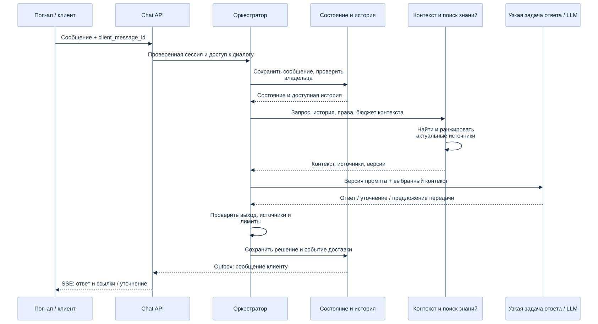
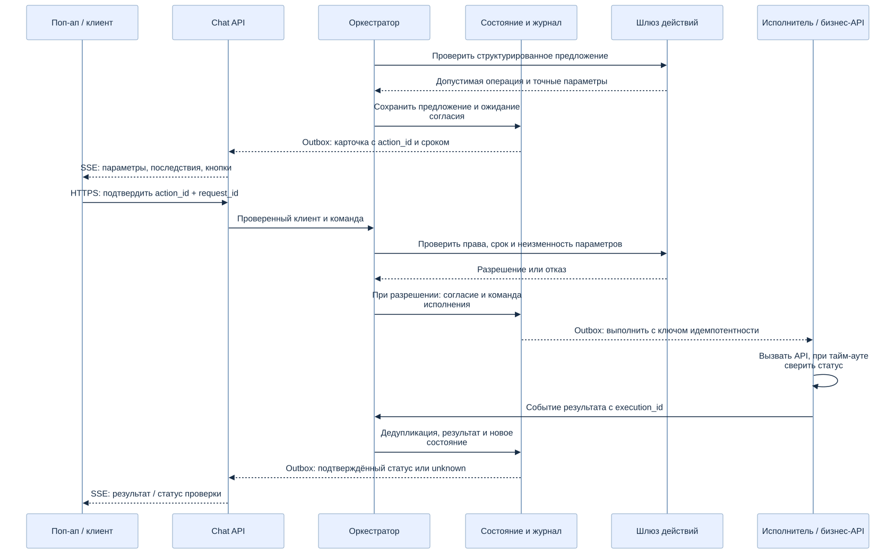
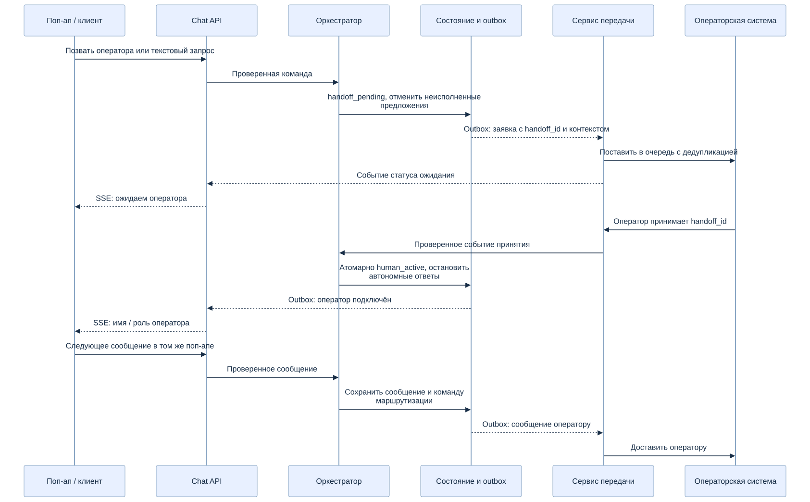
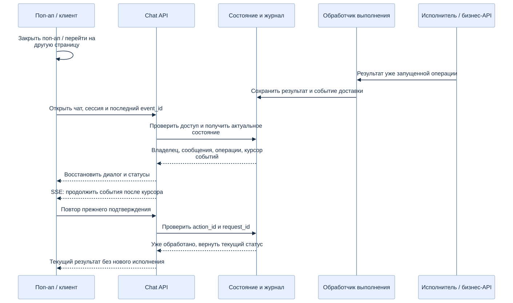

# 4. Сценарии взаимодействия

[К оглавлению HLD](../customer-support-agent-hld.md) · [Подсистемы](01-components.md) · [Состояние](02-state-lifecycle.md)

Диаграммы последовательностей показывают основной путь. Отказы, тайм-ауты и ограничения описаны рядом; пунктирные стрелки включают асинхронные события. «Состояние / outbox» на схемах обозначает хранилище вместе с диспетчером доставки.

## 4.1. Открытие поп-апа и сессия сайта

1. На сайте доступна кнопка поддержки. При открытии поп-апа виджет обращается к Chat API для создания или восстановления диалога.
2. Сервер проверяет авторизацию сайта. Гостю создаётся серверная сессия с доступом только к её диалогу; `customer_id` из браузера не является доказательством личности.
3. Сервер возвращает `conversation_id`, сообщения, владельца, статусы операций и курсор событий. Команды отправляются HTTPS-запросами, ответы и статусы — SSE. Это выбранная схема транспорта HLD.
4. При переходе между страницами, перезагрузке и повторном открытии восстанавливается доступный диалог. Сворачивание поп-апа не завершает его и не отменяет операции.
5. После входа привязка гостевого диалога к аккаунту требует проверки владения гостевой сессией и отдельного правила продукта. При выходе / смене аккаунта виджет очищает персональные данные, закрывает подписку и заново проверяет доступ.

Состояния интерфейса: закрыт / открыт, подключение / онлайн / восстановление / недоступен. Доставка сообщения отображается как «отправляется», «принято» или «ошибка отправки». Эти состояния интерфейса не заменяют серверный жизненный цикл задачи.

## 4.2. FAQ с учётом истории

[Исходник Mermaid](../../images/06-faq-context.mmd).

Chat API подтверждает сообщение после сохранения. Оркестратор проверяет владельца: при `human_active` сообщение направляется оператору. В режиме бота сборщик выбирает доступную историю, резюме и актуальные фрагменты знаний. Модель получает версии инструкций и ограниченный контекст, затем предлагает ответ, уточнение или передачу.

Ответ проверяется на соответствие источникам и ограничениям. Самооценка уверенности модели не служит единственным критерием. При недостаточных источниках агент уточняет вопрос либо предлагает оператора. Он не выводит текущий статус заказа из старой переписки: для этого используется разрешённое чтение бизнес-API.

Для ответа сохраняются ссылки на источники и версии. Перед публикацией повторно проверяется владелец диалога: устаревший ответ бота после передачи оператору не отправляется.

## 4.3. Бизнес-действие с согласия клиента

[Исходник Mermaid](../../images/02-action-consent.mmd).

Шлюз проверяет структурированное предложение. На сервере сохраняются операция, параметры, последствия и срок; в поп-апе отображается карточка с кнопками «Подтвердить» / «Отменить». Нажатие отправляет `action_id` и `request_id`; параметры из браузера не подменяют сохранённую операцию.

Перед разрешением и непосредственно перед исполнением проверяются актуальные права и ограничения. Для чувствительных операций может требоваться повторная аутентификация по правилам продукта. При отказе шлюза команда исполнения не создаётся; клиент получает причину, которую допустимо раскрыть.

Согласие, переход состояния и команда исполнения фиксируются согласованно. Повторный клик или повтор запроса возвращает существующее состояние, а не создаёт новую операцию. Исполнитель использует ключ идемпотентности. При неподтверждённом результате возвращается `unknown` и запускается сверка; клиент не получает ложного сообщения об успехе.

Просроченные, изменённые или отменённые предложения подтвердить нельзя. Отказ клиента не вызывает бизнес-действие. Если отказ или подтверждение пришли одновременно, сервер принимает только один допустимый переход состояния.

## 4.4. Передача оператору в том же поп-апе

[Исходник Mermaid](../../images/07-human-handoff.mmd).

Передача запускается кнопкой, текстовым запросом, правилом политики или предложением модели. Агент сохраняет заявку и переключает диалог в `handoff_pending`. Оператор получает историю, резюме, причину, предпринятые шаги, источники и статусы операций.

Пока заявка ожидает принятия, новые сообщения сохраняются и добавляются в контекст заявки. Новые бизнес-действия и самостоятельные содержательные ответы бота приостановлены; клиент получает статусы очереди. Неисполненные предложения отменяются по правилам [состояния операций](02-state-lifecycle.md#34-состояние-бизнес-действия).

Принятие оператором атомарно меняет владельца на `human_active`. Просроченное принятие закрытой / отменённой заявки отклоняется. Оператор и клиент продолжают общение в том же поп-апе; сообщения сохраняются в общем диалоге. Возврат к боту — отдельный явный переход после освобождения диалога оператором.

Если операторов нет, показывается фактическая доступность и, если продукт поддерживает, возможность создать обращение для последующего ответа. Время ожидания обещается только при наличии соответствующих данных и SLA.

## 4.5. Восстановление после разрыва связи или перезапуска

[Исходник Mermaid](../../images/08-recovery.mmd).

После потери сети виджет показывает статус и переподключается с последним `event_id`. Сервер проверяет доступ заново. Снимок состояния и поток событий согласованы общим курсором: сначала применяется снимок, затем события после его границы; повторные события отбрасываются. Если старые события недоступны, загружается новый снимок.

Открытие поп-апа не запускает повторно уже выполняющуюся операцию. Показываются актуальные серверные статусы карточек и владельца диалога, включая подключённого оператора. Несколько вкладок видят один серверный результат; двойное подтверждение не создаёт второе исполнение.

При перезапуске обработчика ожидающие задачи восстанавливаются из сохранённого состояния. Неотправленные команды продолжают доставляться из outbox. После сбоя между внешним эффектом и записью результата исполнитель использует идемпотентность либо сверку. При неизвестном результате автоматический повтор потенциально необратимой операции запрещён до выяснения статуса.
