# HLD: ИИ-агент поддержки клиентов

Статус: концептуальная архитектура. Учтены подтверждённые 12 принципов разработки агентов и канал общения через поп-ап чат на сайте. Документ описывает проектные решения; компоненты приложения пока не реализованы.

## 1. Контекст и границы системы

### 1.1. Назначение

Агент помогает клиенту в одном всплывающем чате сайта: ищет по FAQ / базе знаний, отвечает с учётом доступной истории, выполняет согласованные бизнес-действия и переводит диалог оператору. Пользователь сохраняет тот же интерфейс при смене бота на оператора.

[Исходник Mermaid](../images/03-overview.mmd).

### 1.2. Основные решения и допущения

- Поп-ап — клиентский интерфейс. Идентификация, LLM, история, состояние, согласия и бизнес-интеграции находятся на сервере.
- Команды передаются через HTTPS, сообщения и статусы доставляются через SSE. Сессия сайта и серверные проверки определяют доступ к диалогу.
- До идентификации посетителю доступен только его гостевой диалог. Прошлые обращения аккаунта читаются после проверки доступа.
- LLM предлагает ответ или структурированный следующий шаг. Оркестратор и шлюз действий проверяют переход, права, согласие и ограничения исполнения.
- Диалог, выполнение агентной задачи и бизнес-операция имеют отдельные состояния в согласованной модели. Закрытие поп-апа не отменяет уже запущенную операцию.
- Состояние, решения и исходящие команды сохраняются. Ожидание не требует активного LLM-запроса; продолжение возможно по проверенному событию клиента, инструмента или оператора.
- Узкие задачи могут быть модулями одного приложения. Схемы отражают логическую структуру и не требуют микросервисов или отдельного workflow-фреймворка.
- Основа проектирования — [12-Factor Agents от HumanLayer](https://github.com/humanlayer/12-factor-agents); соответствие каждому принципу приведено отдельно.

### 1.3. Иерархия документации

| Раздел | Содержание |
| --- | --- |
| [2. Подсистемы](architecture/01-components.md) | Сайт и доступ → управление выполнением → принятие решения → контролируемые возможности → данные → контроль качества |
| [3. Состояние и жизненный цикл](architecture/02-state-lifecycle.md) | Диалог, AgentRun, операция, события, outbox, запуск / ожидание / продолжение |
| [4. Сценарии](architecture/03-scenarios.md) | Открытие поп-апа, FAQ с историей, согласие и действие, оператор, восстановление |
| [5. Сквозные требования](architecture/05-quality-security.md) | Безопасность, ошибки, надёжность, наблюдаемость и проверки |
| [6. Соответствие 12 принципам](architecture/04-12-principles.md) | Принцип → архитектурное решение → проверяемый результат |

### 1.4. Каталог схем

Все схемы сохранены отдельно в `images/`. Mermaid — редактируемый источник; SVG — изображение, отрендеренное из этого источника. Иерархия компонентов и потоки взаимодействия показаны отдельно.

| Уровень / сценарий | Изображение | Исходник |
| --- | --- | --- |
| Обзор системы | [03-overview.svg](../images/03-overview.svg) | [Mermaid](../images/03-overview.mmd) |
| Иерархия компонентов | [01-components.svg](../images/01-components.svg) | [Mermaid](../images/01-components.mmd) |
| Состояние и обработка событий | [04-state-model.svg](../images/04-state-model.svg) | [Mermaid](../images/04-state-model.mmd) |
| Жизненный цикл задачи | [05-run-lifecycle.svg](../images/05-run-lifecycle.svg) | [Mermaid](../images/05-run-lifecycle.mmd) |
| Ответ по FAQ и истории | [06-faq-context.svg](../images/06-faq-context.svg) | [Mermaid](../images/06-faq-context.mmd) |
| Подтверждение действия | [02-action-consent.svg](../images/02-action-consent.svg) | [Mermaid](../images/02-action-consent.mmd) |
| Передача оператору | [07-human-handoff.svg](../images/07-human-handoff.svg) | [Mermaid](../images/07-human-handoff.mmd) |
| Восстановление | [08-recovery.svg](../images/08-recovery.svg) | [Mermaid](../images/08-recovery.mmd) |

### 1.5. Что уточнить перед реализацией

1. Домены сайта, способ авторизации, правила гостевых сессий и привязки истории после входа.
2. Перечень бизнес-действий, последствия, отменяемость, дополнительная аутентификация и поддержка идемпотентности / сверки внешними API.
3. Источники знаний, ответственность за актуальность и права доступа.
4. CRM / контакт-центр, интеграционные API, правила очереди, часы работы и возврат диалога боту.
5. Нагрузка, задержка, SLA, бюджеты шагов / стоимости, сроки ожидания и измеримые критерии качества.
6. Размещение данных и LLM, сроки хранения, удаление и требования к персональным данным.

Эти вопросы не меняют четыре основные возможности, но определяют конкретные технологии, политики и эксплуатационные ограничения.
